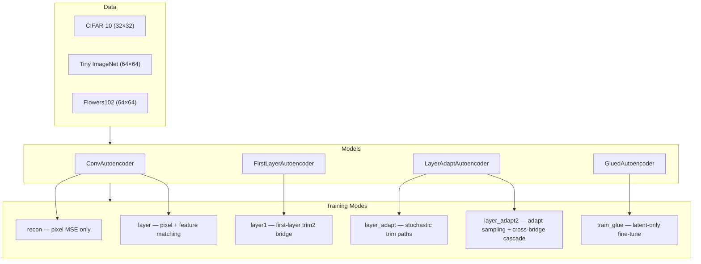
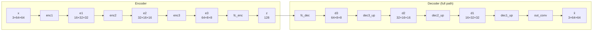
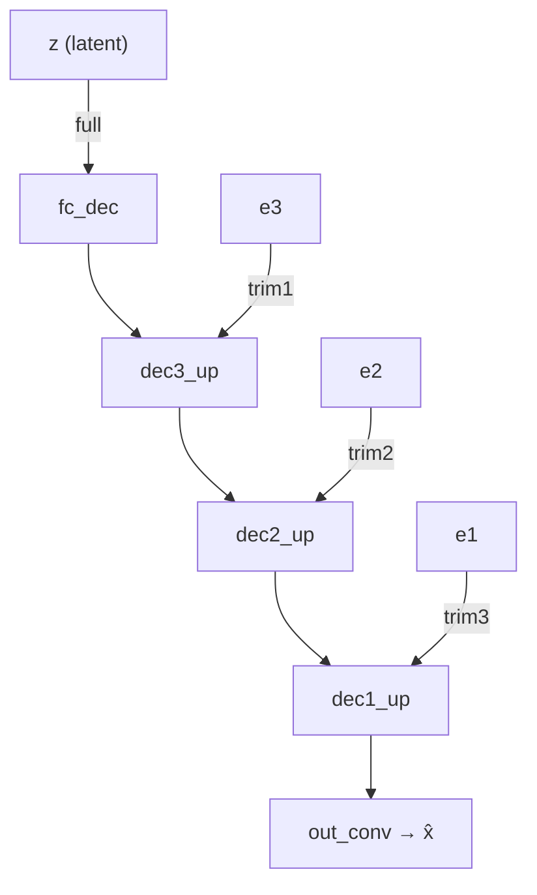
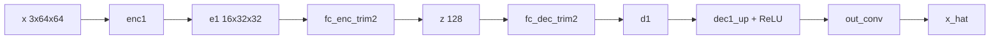
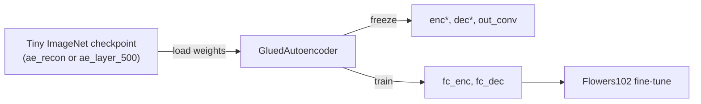
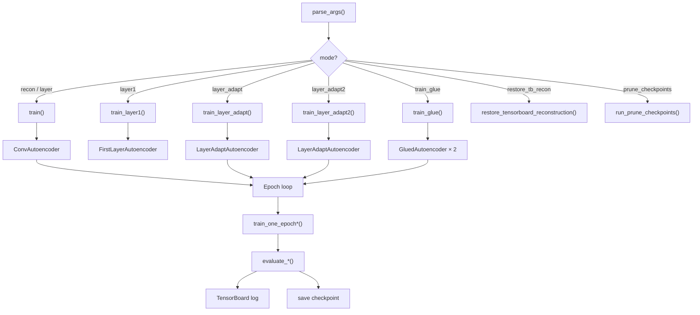

# Autoencoder Training Architecture

This document describes the architecture of `train_autoencoder.py`: a convolutional autoencoder family trained on image datasets with multiple reconstruction paths, layer-matching losses, and domain-transfer (glue) fine-tuning.

---

## High-Level Overview



| Component | Role |
|-----------|------|
| **ConvAutoencoder** | Base encoder–decoder; supports 4 trim decode paths via encoder skip splice |
| **FirstLayerAutoencoder** | Standalone `enc1` + LayerAdapt trim2 bridges (`fc_enc_trim2` / `fc_dec_trim2`) + `dec1_up` / `out_conv` |
| **LayerAdaptAutoencoder** | Extends base model with shared-latent bridges at e2 and e1 for 3 decode paths |
| **GluedAutoencoder** | Copy of ConvAutoencoder for Flowers102 transfer; latent layers fine-tuned while conv blocks frozen |
| **TensorBoard** | Logs loss, accuracy, LR, alpha, reconstructions |
| **Checkpoints** | Saved under `checkpoints/<run_name>/epoch_*.pt` |

---

## Building Block: EncoderBlock

Each encoder stage is a stride-2 convolution that halves spatial resolution and doubles (or sets) channel width.

```
Input [B, C_in, H, W]
  └─ Conv2d(C_in → C_out, k=3, stride=2, padding=1, bias=False)
  └─ BatchNorm2d(C_out)
  └─ ReLU
Output [B, C_out, H/2, W/2]
```

Default channel schedule: `(c1, c2, c3) = (16, 32, 64)`.

---

## ConvAutoencoder

The core model has **no skip connections** in the forward path. Trim evaluation instead **splices encoder features directly** into the decoder by bypassing lower decoder stages.

### Default hyperparameters

| Parameter | Default | Notes |
|-----------|---------|-------|
| `latent_dim` | 128 | Bottleneck vector size |
| `channels` | (16, 32, 64) | Per-stage channel widths |
| `bottleneck_size` | 8 | Spatial size at deepest encoder feature (e3) for 64×64 input |

### Tensor shapes (64×64 input, default config)

| Stage | Module | Output shape |
|-------|--------|--------------|
| Input | — | `[B, 3, 64, 64]` |
| e1 | enc1 | `[B, 16, 32, 32]` |
| e2 | enc2 | `[B, 32, 16, 16]` |
| e3 | enc3 | `[B, 64, 8, 8]` |
| z | fc_enc | `[B, 128]` |
| d3 | fc_dec → view | `[B, 64, 8, 8]` |
| — | dec3_up | `[B, 32, 16, 16]` |
| d2 | (after dec3_up + ReLU) | `[B, 32, 16, 16]` |
| — | dec2_up | `[B, 16, 32, 32]` |
| d1 | (after dec2_up + ReLU) | `[B, 16, 32, 32]` |
| — | dec1_up | `[B, 16, 64, 64]` |
| Output | out_conv | `[B, 3, 64, 64]` |

Decoder upsampling uses `ConvTranspose2d(k=4, stride=2, padding=1)`. Final RGB projection is `Conv2d(c1, 3, k=3, padding=1)`.

### Full encoder–decoder diagram



### Trim decode paths (ConvAutoencoder)

During evaluation, the same encoded features `(e1, e2, e3, z)` are decoded through four named methods:

| Path | Method | Decode flow | Removed stages |
|------|--------|-------------|----------------|
| **val_full** | `decode_full(z)` | `fc_dec(z) → dec3_up → dec2_up → dec1_up → out_conv` | — |
| **trim1** | `decode_trim1(e3)` | `e3 → dec3_up → dec2_up → dec1_up → out_conv` | fc_dec |
| **trim2** | `decode_trim2(e2)` | `e2 → dec2_up → dec1_up → out_conv` | fc_dec, dec3_up |
| **trim3** | `decode_trim3(e1)` | `e1 → dec1_up → out_conv` | fc_dec, dec3_up, dec2_up |



---

## LayerAdaptAutoencoder

Extends `ConvAutoencoder` with **shared-latent bridges** so trim paths encode intermediate features into the same 128-d latent space before decoding.

### Additional modules

| Module | Maps | Purpose |
|--------|------|---------|
| `fc_enc_trim1` | e2 flattened → z | Encode from 32×16×16 features |
| `fc_dec_trim1` | z → e2-shaped tensor | Decoder entry for trim1 (analogous to `fc_dec`) |
| `fc_enc_trim2` | e1 flattened → z | Encode from 16×32×32 features |
| `fc_dec_trim2` | z → e1-shaped tensor | Decoder entry for trim2 (analogous to `fc_dec`) |

Helper methods mirror the full-path `encode` / `decode_full` API:

| Method | Flow |
|--------|------|
| `encode_trim1(e2)` | `fc_enc_trim1(e2)` → z |
| `_dec_entry_trim1(z)` | `fc_dec_trim1(z)` → view → ReLU → d2 |
| `encode_trim2(e1)` | `fc_enc_trim2(e1)` → z |
| `_dec_entry_trim2(z)` | `fc_dec_trim2(z)` → view → ReLU → d1 |

### Three decode paths (training + eval)

| Path | Method | Flow |
|------|--------|------|
| **full** | `decode_full(z)` | `fc_enc(e3) → z → fc_dec → dec3_up → dec2_up → dec1_up → out_conv` |
| **trim1** | `decode_trim1(e2)` | `fc_enc_trim1(e2) → z → fc_dec_trim1 → dec2_up → dec1_up → out_conv` |
| **trim2** | `decode_trim2(e1)` | `fc_enc_trim2(e1) → z → fc_dec_trim2 → dec1_up → out_conv` |

Note: `decode_trim1` / `decode_trim2` on `LayerAdaptAutoencoder` take encoder features (`e2`, `e1`) and return a full image. On `ConvAutoencoder`, the same names splice `e3` / `e2` / `e1` directly (trim1 uses `e3`, not `e2`).


There is **no e3-splice trim level** in LayerAdapt (unlike ConvAutoencoder trim1).

---

## FirstLayerAutoencoder

Standalone model with only the first encoder stage plus LayerAdapt **trim2** latent bridges (same module names and shapes as `LayerAdaptAutoencoder.decode_trim2`).

### Modules

| Module | Role |
|--------|------|
| `enc1` | First encoder block (3 → 16 channels, 64×64 → 32×32) |
| `fc_enc_trim2` | e1 flattened → z |
| `fc_dec_trim2` | z → e1-shaped tensor (decoder entry) |
| `dec1_up` | Upsample to 64×64 |
| `out_conv` | 16 → 3 RGB |

### Forward path

```
x → enc1 → e1 → fc_enc_trim2 → z → ReLU(fc_dec_trim2(z)) → ReLU(dec1_up) → out_conv
```



No `enc2`/`enc3`, no `fc_enc`/`fc_dec`, no trim1 bridges, no `dec2_up`/`dec3_up`.

---

## GluedAutoencoder

Structurally identical to `ConvAutoencoder`. Used for **Flowers102 domain transfer**:

1. Weights loaded from a pretrained Tiny ImageNet checkpoint (`ae_recon` or `ae_layer_500`).
2. Only `fc_enc` and `fc_dec` are trainable; all conv/BN modules are frozen and kept in eval mode.
3. Trains on full forward MSE while conv weights stay fixed.

### Glue training flow



Two independent glue runs:

| Run name | Init checkpoint | Tag |
|----------|-----------------|-----|
| `flowers102_glue_layer_latent` | `tiny_imagenet_ae_layer_500` | `glue_layer_latent` |
| `flowers102_glue_recon_latent` | `tiny_imagenet_ae_recon` | `glue_recon_latent` |

---

## Training Modes & Loss Functions

### Mode summary

| CLI `--mode` | Model | Dataset (typical) | Loss |
|--------------|-------|-------------------|------|
| `recon` | ConvAutoencoder | Tiny ImageNet | `MSE(x, x_full)` |
| `layer` | ConvAutoencoder | Tiny ImageNet | Pixel + feature cascade (see below) |
| `layer1` | FirstLayerAutoencoder | Tiny ImageNet | `MSE(x, x_hat)` on trim2 bridge path |
| `layer_adapt` | LayerAdaptAutoencoder | Tiny ImageNet | Stochastic path pixel MSE |
| `layer_adapt2` | LayerAdaptAutoencoder | Tiny ImageNet | Adapt sampling + cross-bridge cascade |
| `train_glue` | GluedAutoencoder ×2 | Flowers102 | Full forward pixel MSE (latent only) |

### `recon` — reconstruction only

```
L = MSE(x, x_full)
```

Trains only the full decode path via `forward()` / `decode_full(z)`. Trim metrics are logged for comparison but not optimized.

### `layer1` — first-layer trim2 bridge

```
L = MSE(x, x_hat)
```

Single path: `enc1 → fc_enc_trim2 → z → fc_dec_trim2 → dec1_up → out_conv`. Trained from scratch; TensorBoard logs `val_recon` / `val_acc` and 2-row reconstruction cards (input + recon).

### `layer` — feature matching

Aligns encoder features with decoder intermediate activations at matching resolutions:

```
L = α⁰ · MSE(x, x_full)
  + α¹ · MSE(e3, d3)
  + α² · MSE(e2, d2)
  + α³ · MSE(e1, d1)
```

Where `d3 = relu(fc_dec(z))`, `d2 = relu(dec3_up(d3))`, `d1 = relu(dec2_up(d2))`.

**Alpha schedule:** ramps from `alpha_start` → `alpha_end` over training (default 0 → 1), or fixed via `--alpha-schedule constant`.

### `layer_adapt` — stochastic trim paths

Each batch randomly samples one of `{full, trim1, trim2}` with weights `(1, α, α²)` and minimizes pixel MSE on that path only.

### `layer_adapt2` — adapt sampling + cross-bridge cascade

Same path sampling as `layer_adapt`: each batch randomly samples one of `{full, trim1, trim2}` with weights `(1, α, α²)`.

Let `z = fc_enc(e3)`, `z1 = fc_enc_trim1(e2)`, `z2 = fc_enc_trim2(e1)`, `d_trim1(z) = fc_dec_trim1(z)` (e2-shaped), `d_trim2(z) = fc_dec_trim2(z)` (e1-shaped). Full-path decoder: `d2 = relu(dec3_up(relu(fc_dec(z))))`, `d1 = relu(dec2_up(d2))`.

| Path | Loss |
|------|------|
| **full** | `MSE(x,x_full) + α(MSE(z,z1)+MSE(d2,d_trim1(z))) + α²(MSE(z,z2)+MSE(d1,d_trim2(z)))` |
| **trim1** | `MSE(x,x_trim1) + α(MSE(z1,z2)+MSE(dec2_up(d_trim1(z1)),d_trim2(z1)))` |
| **trim2** | `MSE(x,x_trim2)` only (no cascade terms) |

**Alpha schedule:** same as `layer` — ramps `alpha_start` → `alpha_end` (default 0 → 1).

---

## Training Pipeline



### Optimizer & scheduler

- **Optimizer:** SGD (`lr=0.01`, momentum=0.9, weight_decay=1e-5)
- **Scheduler:** MultiStepLR at epochs `[epochs/2, 3·epochs/4]`, gamma=0.1
- **Glue latent-only:** same optimizer but only `fc_enc` / `fc_dec` parameters

### Outputs

| Artifact | Location |
|----------|----------|
| TensorBoard logs | `runs/<run_name>/` |
| Checkpoints | `checkpoints/<run_name>/epoch_*.pt`, `latest.pt` |
| Data | `./data/` (auto-downloaded) |

### TensorBoard groups

| Group | Content |
|-------|---------|
| `1_Loss` | Train/val MSE, path losses, feature components |
| `2_Accuracy` | Pixel accuracy (all RGB within threshold 0.1) |
| `3_Reconstruction` | Fixed sample recon grids |
| `4_Reconstruction_Random` | Stratified-by-class recon grids (fixed seed `RECON_RANDOM_SEED=0`) |
| `Schedule` | LR, alpha, path sampling weights |

Scalar tags use **path semantics** (layer count + whether latent bridge is active). Internal Python dict keys (`val_recon_full`, `val_recon_trim1`, …) are unchanged; only TensorBoard tag strings differ. Historical event files with legacy tag names can be migrated in-place via `python train_autoencoder.py --mode rewrite_tb_scalars` (optional `--run-name`, `--dry-run`).

| Model family | Internal key | TB loss tag | TB accuracy tag |
|--------------|--------------|-------------|-----------------|
| ConvAE | `val_recon_full` / `val_acc_full` | `val_recon_3layer_latent` | `val_acc_3layer_latent` |
| ConvAE | `val_recon_trim1` / `val_acc_trim1` | `val_recon_3layer` | `val_acc_3layer` |
| ConvAE | `val_recon_trim2` / `val_acc_trim2` | `val_recon_2layer` | `val_acc_2layer` |
| ConvAE | `val_recon_trim3` / `val_acc_trim3` | `val_recon_1layer` | `val_acc_1layer` |
| LayerAdapt | `val_recon_full` / `val_acc_full` | `val_recon_3layer_latent` | `val_acc_3layer_latent` |
| LayerAdapt | `val_recon_trim1` / `val_acc_trim1` | `val_recon_2layer_latent` | `val_acc_2layer_latent` |
| LayerAdapt | `val_recon_trim2` / `val_acc_trim2` | `val_recon_1layer_latent` | `val_acc_1layer_latent` |
| FirstLayer | `val_recon` / `val_acc` | `val_recon_1layer_latent` | `val_acc_1layer_latent` |
| Glue | full model | `val_recon_3layer_latent` | `val_acc_3layer_latent` |
| Glue | bookends | `val_recon_1layer` | `val_acc_1layer` |

---

## Evaluation Metrics

All reconstruction metrics are **per-element pixel MSE** (lower is better). Pixel accuracy counts images where every denormalized RGB value is within `0.1` of the input.

Checkpoint dicts and console format strings use **internal keys** below. TensorBoard scalar tags use the path names in the table above (`val_recon_3layer_latent`, `val_recon_1layer`, …).

### ConvAutoencoder (`recon`, `layer`)

| Internal key | Meaning | TB stem |
|--------------|---------|---------|
| `val_recon_full` | MSE(x, x_full) | `val_recon_3layer_latent` |
| `val_recon_trim1` | MSE(x, x_trim1) — e3 splice | `val_recon_3layer` |
| `val_recon_trim2` | MSE(x, x_trim2) — e2 splice | `val_recon_2layer` |
| `val_recon_trim3` | MSE(x, x_trim3) — e1 splice | `val_recon_1layer` |

### LayerAdaptAutoencoder (`layer_adapt`, `layer_adapt2`)

| Internal key | Meaning | TB stem |
|--------------|---------|---------|
| `val_recon_full` | Full latent bridge path | `val_recon_3layer_latent` |
| `val_recon_trim1` | e2 → fc_enc_trim1 → z → fc_dec_trim1 path | `val_recon_2layer_latent` |
| `val_recon_trim2` | e1 → fc_enc_trim2 → z → fc_dec_trim2 path | `val_recon_1layer_latent` |

### FirstLayerAutoencoder (`layer1`)

| Internal key | Meaning | TB stem |
|--------------|---------|---------|
| `val_recon` | MSE(x, x_hat) on the single trim2 bridge path | `val_recon_1layer_latent` |
| `val_acc` | Pixel accuracy on the same path | `val_acc_1layer_latent` |

### GluedAutoencoder (`train_glue`)

| Path | Meaning | TB loss / accuracy stems |
|------|---------|--------------------------|
| Full model | fc_enc → z → fc_dec → dec upsample stack | `val_recon_3layer_latent` / `val_acc_3layer_latent` |
| Bookends | enc1 → dec1_up only (1-layer path) | `val_recon_1layer` / `val_acc_1layer` |

---

## Active Runs

| Run name | Mode | Model |
|----------|------|-------|
| `tiny_imagenet_ae_recon` | recon | ConvAutoencoder |
| `tiny_imagenet_ae_layer_500` | layer | ConvAutoencoder |
| `tiny_imagenet_ae_recon_l1` | layer1 | FirstLayerAutoencoder |
| `tiny_imagenet_ae_layer_adapt_500` | layer_adapt | LayerAdaptAutoencoder |
| `tiny_imagenet_ae_layer_adapt_300` | layer_adapt | LayerAdaptAutoencoder |
| `tiny_imagenet_ae_layer_adapt2` | layer_adapt2 | LayerAdaptAutoencoder |
| `flowers102_glue_layer_latent` | train_glue | GluedAutoencoder |
| `flowers102_glue_recon_latent` | train_glue | GluedAutoencoder |

---

## Datasets & Normalization

| Dataset | Resolution | Normalization |
|---------|------------|---------------|
| CIFAR-10 | 32×32 (native) | CIFAR-10 mean/std |
| Tiny ImageNet | 64×64 (native) | ImageNet mean/std |
| Flowers102 | 64×64 (resized) | ImageNet mean/std |

Augmentations: random horizontal flip; CIFAR-10 also uses random crop with padding.

---

## Class Hierarchy

```
nn.Module
├── EncoderBlock
├── ConvAutoencoder
│   └── LayerAdaptAutoencoder
├── FirstLayerAutoencoder
└── GluedAutoencoder
```

`GluedAutoencoder` is a standalone copy (not a subclass) of `ConvAutoencoder` with identical layout plus glue-specific forward helpers (`forward_bookends`, `forward_trim1/2/3`).
